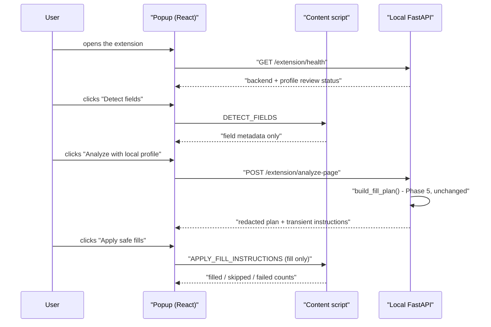

# Phase 6: Chrome extension integration

Phase 6 adds a Chrome extension prototype that reads the form on the page you are
looking at, asks the local backend what to do with each field using the Phase 5
mapping engine, shows you the plan, and fills only the fields you approve.

It is a prototype for **local sample forms only**. It does not automate real job
sites, and it never submits anything.

## What Phase 6 adds

| Area | Addition |
| --- | --- |
| Backend models | `ExtensionDetectedField`, `ExtensionAnalyzeRequest`, `ExtensionFillInstruction`, `ExtensionAnalyzeResponse`, `ExtensionHealthResponse`, plus validate-page request/response |
| Backend service | `extension_field_adapter` - converts extension metadata into Phase 5 inputs and gates which decisions may carry a real value |
| Backend routes | `GET /extension/health`, `POST /extension/analyze-page`, `POST /extension/validate-page` |
| Backend hosting | `/sample-forms/*` static mount so the sample forms are reachable over http |
| Extension | Manifest V3 extension in `extension/` with a React popup, a content script, and a minimal service worker |

Phases 1-5 are untouched apart from three additive changes in
`backend/app/main.py`, described under [Existing files touched](#existing-files-touched).

## How the extension integrates with the backend



The popup is the only component that talks to the network, and the content script
is the only component that touches the DOM. Keeping those separate means page
context never gets network access, and the backend never gets page content.

## Why the extension is limited to local development pages

Both the extension and the backend enforce the same allow-list:

```
http://127.0.0.1:8000    http://localhost:8000
http://127.0.0.1:5173    http://localhost:5173
http://127.0.0.1:8080    http://localhost:8080
```

- The manifest requests `host_permissions` for only those six origins, so Chrome
  will not inject the content script anywhere else. There is no `<all_urls>`, no
  job-board domain, and no `tabs`/`history`/`cookies` permission.
- `POST /extension/analyze-page` rejects any other `page_url` with HTTP 400, so
  even a modified extension cannot get a plan for a real job site.

The origin comparison is on scheme + host + port exactly, so a lookalike host such
as `http://127.0.0.1.example.com:8000` does not pass.

The reason for two layers is that they fail differently: the manifest stops the
content script from running, and the backend check stops analysis even if the
manifest were widened by hand.

## How field detection works in the content script

`extension/src/content/fieldDetector.ts` walks `input, textarea, select, button`
and records, per element:

- tag name, input type, `name`, `id`, `placeholder`, `aria-label`, `autocomplete`
- label text from `label[for=...]`, then a wrapping `<label>`
- a short slice of the surrounding wrapper's text (capped at 160 characters)
- `<select>` option labels
- `required`, `visible`, `disabled`, `readonly`
- file-upload, submit-control, textarea, select, checkbox, and radio flags
- a stable CSS selector

Password inputs are skipped before any metadata is read from them.

### Selector strategy and its limitations

Selectors are chosen in this order, each candidate accepted only if it matches
exactly one element on the page:

1. `#id`
2. `tag[name="..."]`
3. `[data-testid="..."]` or `[data-test="..."]`
4. an `nth-of-type` path from the document root

The `nth-of-type` fallback is only as stable as the DOM. If the page re-renders
between "Detect fields" and "Apply safe fills" - a React-controlled form, a wizard
advancing a step - a fallback selector can go stale. When that happens the fill is
reported as **failed** with a warning rather than applied to a different element.
For the local sample forms this does not arise, because detection and filling
happen in the same static page.

This detector is separate from the Playwright detector in
`backend/app/services/form_field_detector.py`. They are kept apart on purpose -
that one belongs to Phase 4 and runs inside a Playwright-controlled browser - but
they emit the same metadata shape, so the mapping engine treats both identically.

## How the extension reuses the Phase 5 mapping engine

`POST /extension/analyze-page` does not contain any mapping logic. It converts the
request into `FormField` objects and calls the existing engine:

```python
form_fields, dropped_password_ids = convert_extension_fields_to_form_fields(body.fields)
form_name = resolve_form_name(body.form_name, body.page_url)
fill_plan = build_fill_plan(form_name, body.page_url, form_fields, profile)
```

Everything the dashboard shows you also applies here: classification, confidence
scoring, evidence, sensitive-field detection, redaction, and local mapping
overrides.

Because `resolve_form_name` maps a sample form's file name back to its short name
(`basic-application.html` becomes `basic`), an override you saved from the
dashboard also applies when the extension analyzes the same form.

## What data is sent to the backend

Only field metadata, plus the page URL and title:

```json
{
  "page_url": "http://127.0.0.1:8000/sample-forms/basic-application.html",
  "page_title": "Basic Application",
  "form_name": "basic-application.html",
  "fields": [
    {
      "field_id": "field-0",
      "selector": "#first_name",
      "tag_name": "input",
      "input_type": "text",
      "name": "first_name",
      "label_text": "First name",
      "autocomplete": "given-name",
      "required": true,
      "visible": true
    }
  ]
}
```

## What is not sent, and what is not stored

Never sent to the backend:

- values already typed into the page's fields
- page HTML, full page text, or screenshots
- anything about password fields
- text beyond the 160-character nearby-text slice per field

Never stored anywhere:

- resolved fill values - they exist only in the HTTP response body and in popup
  memory, and are gone when you close the popup
- profile data in `chrome.storage`; the only stored setting is the backend URL
- page content in reports, logs, or override files

A backend test (`test_analyze_page_writes_nothing_to_disk`) asserts that an
extension analysis creates no file at all.

Nothing in Phase 6 contacts a cloud service. There are no API keys, no analytics,
and no remotely hosted code.

## How transient fill instructions work

The response has two halves, and the split is the whole privacy model:

- **`fill_plan`** is what the popup displays. Its `value_preview` fields are
  redacted by Phase 5 (`ada@example.com` shows as `a***@example.com`).
- **`instructions`** is what the content script consumes. An instruction carries a
  real `value` only when *every* one of these holds:
  - `action == "fill"`
  - the field is not sensitive and the category is not in `SENSITIVE_CATEGORIES`
  - the profile actually resolved a value (`missing_value` is false)
  - the element is not a password, file upload, or submit control
  - the element is not disabled, readonly, or hidden
  - the element is not a checkbox or radio

Anything else gets `value: null`. The content script then re-checks all of the
same conditions in `safeFiller.ts` before touching the DOM, so a bug or a tampered
response still cannot cause an unsafe fill.

## Why sensitive and legal fields are never autofilled

Work authorization, sponsorship, salary expectations, demographic questions,
disability and veteran status, criminal history, and legal acknowledgments are
answers you are personally attesting to. A wrong answer generated from a resume
parse is a serious problem, not a typo. Phase 5 routes every such field to
`manual_review`; Phase 6 additionally refuses to send a value for them and
refuses to write one if it somehow received it. Even a user-created mapping
override cannot force a sensitive field to autofill.

## Why file uploads are manual review in Phase 6

A page's `<input type="file">` cannot be populated from JavaScript for security
reasons - browsers only accept a real user file selection - and even where a
`DataTransfer` workaround exists, silently attaching a resume is not something
that should happen without an explicit click. File inputs are highlighted as
manual review so you can attach the file yourself.

## Setup and testing

### 1. Run the backend

```bash
cd backend
.venv\Scripts\activate        # Windows; use source .venv/bin/activate elsewhere
uvicorn app.main:app --reload
```

Confirm it is up: <http://127.0.0.1:8000/extension/health>

You need a saved profile. If you have not made one, upload a resume in the
dashboard (`frontend/`) and save the reviewed profile, or `PUT /profile` directly.

### 2. Build the extension

```bash
cd extension
npm install
npm run build
```

This produces `extension/dist/`, which is the folder Chrome loads.

### 3. Load the unpacked extension

1. Open `chrome://extensions`.
2. Turn on **Developer mode** (top right).
3. Click **Load unpacked**.
4. Select `extension/dist`.

After any later `npm run build`, click the reload icon on the extension card.

### 4. Open a local sample form

The backend serves the repo's sample forms over http:

- <http://127.0.0.1:8000/sample-forms/basic-application.html>
- <http://127.0.0.1:8000/sample-forms/engineering-application.html>
- <http://127.0.0.1:8000/sample-forms/edge-case-labels.html>
- <http://127.0.0.1:8000/sample-forms/sensitive-fields.html>
- <http://127.0.0.1:8000/sample-forms/select-radio-checkboxes.html>

Use the `127.0.0.1:8000` URL rather than a `file://` path - the content script is
only injected on the allow-listed http origins.

### 5. Test the full flow

1. Open the sample form, then click the extension icon.
2. Check the popup shows the backend version and your profile's review status.
3. Click **Detect fields** - the detected count should match the form.
4. Click **Analyze with local profile** - you get fill / suggest / manual review /
   skip counts and a per-field review list.
5. Click **Highlight decisions** - each field gets a coloured outline and a badge;
   hover a badge for the action, category, confidence, and reason.
6. Click **Apply safe fills** - only the `fill` fields get values. The form is not
   submitted.
7. Click **Clear highlights** to reset the page decoration.

Then try `sensitive-fields.html`: the fill count should be **0**, every sensitive
field should be badged as manual review, and **Apply safe fills** should be
disabled.

### Backend tests

```bash
cd backend
.venv\Scripts\python.exe -m pytest -q
```

The Phase 6 tests need no Chrome, no loaded extension, and no network. They use
`TestClient` with `monkeypatch` to redirect profile and override storage into
`tmp_path`.

## Existing files touched

Only one existing backend file changed: `backend/app/main.py`.

1. **Router inclusion** - `app.include_router(extension.router)`. The new
   endpoints are unreachable otherwise.
2. **CORS** - the popup's origin is `chrome-extension://<id>`, and that id is not
   known until you load the unpacked extension, so it cannot be pinned in advance.
   The existing single `add_middleware` call gained
   `allow_origin_regex=r"^chrome-extension://[a-z]{32}$"` and the 8000/8080
   loopback origins. The 5173 entries the dashboard relies on are unchanged, and
   this remains a development-only allowance.
3. **Static mount** - `/sample-forms` serves the existing HTML files read-only,
   because extensions are awkward to test on `file://` URLs. The Playwright
   prototype still loads the same files from disk and is unaffected.

Documentation files (`README.md`, `backend/README.md`) and `.gitignore` also
changed, but no Phase 1-5 behaviour did.

## Deviations from the original Phase 6 plan

- Tests live in `backend/tests/`, not `backend/app/tests/`, because
  `pyproject.toml` sets `testpaths = ["tests"]` and every existing test module is
  already there.
- `popup.html` sits at `extension/popup.html` rather than `src/popup/`, so Vite
  emits `dist/popup.html` instead of a nested `dist/src/popup/popup.html` that the
  manifest would have to reference.
- The popup and the content/worker scripts are built by two different tools. Vite
  builds the React popup; esbuild bundles the content script and service worker as
  IIFE, because Manifest V3 will not load a content script containing bare ES
  module imports.
- No TypeScript unit-test runner was added. Detection, filtering, and allow-list
  logic are exported as pure functions (`buildStableSelector`,
  `filterFillableInstructions`, `isAllowedPageUrl`) so a test runner can be added
  in Phase 7 without restructuring.

## Known limitations

- Selector staleness on dynamic pages, as described above.
- Checkboxes and radios are never set, even when a confident mapping exists.
- `<select>` fields only change on an exact normalized option match; anything else
  becomes a suggestion.
- Only one form per page is handled; all controls on the page are treated as one
  set of fields.
- `<iframe>` content is not reached - the content script runs in the top frame.
- Shadow DOM fields are not detected.
- The popup discards its state when closed. Reopening it means detecting and
  analyzing again, which is intentional: it guarantees no profile value survives
  in extension memory.
- `resolve_form_name` only knows the repo's sample forms; any other page shares the
  single `extension-page` override namespace.

## What should come next in Phase 7

- **Per-field approval.** Let the user tick individual fields in the popup instead
  of applying all `fill` decisions at once.
- **Override editing from the popup**, reusing the Phase 5 override endpoints so a
  correction can be made without switching to the dashboard.
- **TypeScript unit tests** (vitest plus jsdom) for the detector, the safe filler,
  and the allow-list, plus an end-to-end test driving the built extension.
- **Better dynamic-form handling** - re-resolve selectors immediately before
  filling, and watch for DOM mutations that invalidate a plan.
- **Iframe and shadow-DOM detection**, which most real application forms need.
- **A considered decision about real sites.** Widening beyond loopback origins is
  the point where terms-of-service, rate-limiting, and consent questions become
  real. It should be a deliberate, documented step with a per-site allow-list, not
  a permissions change.
