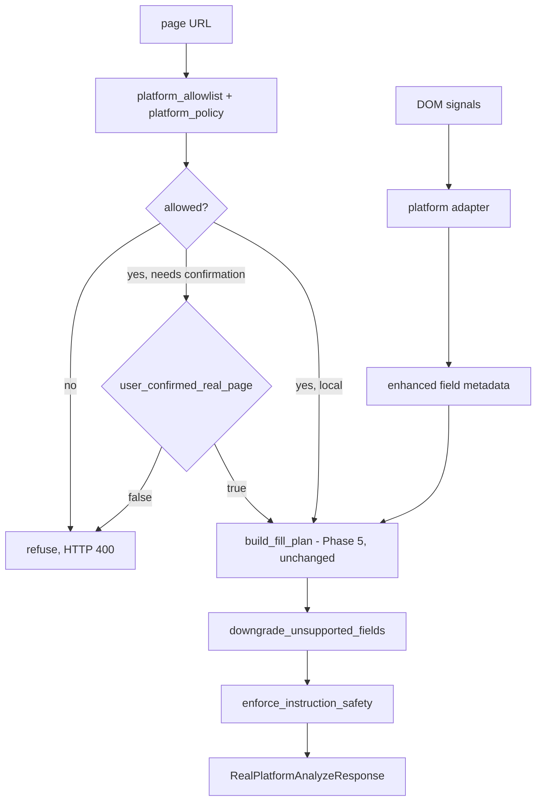

# Phase 7: Controlled real application platform support

Phase 6 restricted the extension to local sample forms. Phase 7 lets you point it at a
real application page **you** opened, on a platform that is explicitly supported, after
you confirm that you want it analyzed.

Everything Phase 6 refused to do, Phase 7 still refuses to do. There is no scraping, no
mass apply, no navigation, no login automation, no captcha handling, no bot evasion, no
auto-submit, no clicking, no generated answers, and no resume tailoring. The extension
reads the page in front of you, proposes a plan, and fills the plain fields you
approve. You review the form and you submit it.

## What Phase 7 adds

| Area | Addition |
| --- | --- |
| Backend models | `SupportedPlatform`, `PlatformDetection`, `PageSafetyDecision`, `RealPlatformAnalyzeRequest`, `RealPlatformAnalyzeResponse` in `app/models/platform.py` |
| Backend service | `platform_allowlist` - which URLs are in scope, and what platform they are |
| Backend service | `platform_policy` - the safety rules: confirmation, downgrades, and a final value-stripping pass |
| Backend routes | `GET /platforms/supported`, `POST /platforms/check-url`, `POST /extension/analyze-real-page` |
| Backend hosting | `/test-fixtures/*` static mount for the synthetic platform fixtures |
| Extension shared | `platformTypes.ts`, `urlSafety.ts`, `permissions.ts` |
| Extension content | `platformDetector.ts` and six adapters under `content/adapters/` |
| Extension popup | `PlatformStatus`, `RealPageWarning`, `FillPlanReview`, and the real-page flow in `Popup.tsx` |
| Extension tests | `vitest` + `jsdom`, 100 specs covering the safety-critical helpers |
| Fixtures | Six synthetic platform pages in `test-fixtures/platform-pages/` |

`POST /extension/analyze-page` - the Phase 6 endpoint - is untouched. Local pages take
exactly the path they took before.

## The two-question design

Everything in this phase follows from keeping two questions apart:

1. **May this page be analyzed at all?** Answered from the **URL**, by the **backend**,
   on every request. Fails closed.
2. **How should this page be read?** Answered from **DOM signals**, by the
   **extension**, by choosing an adapter.



The two answers are allowed to disagree, and the disagreement is recorded in
`matched_by` rather than resolved silently. This is what makes local fixtures useful: a
Greenhouse-shaped fixture served from `127.0.0.1:8000` is a `local` page as far as
safety is concerned (no confirmation, Phase 6 behaviour) while its markup still selects
the Greenhouse adapter. The adapters get exercised without a real site being touched.

## Which pages are in scope

Host matching is exact-host or proper-suffix, never substring, and real platforms must
be `https`:

| Platform | Patterns |
| --- | --- |
| `local` | the six loopback origins from Phase 6 |
| `greenhouse` | `.greenhouse.io` |
| `lever` | `.lever.co` |
| `ashby` | `.ashbyhq.com` |
| `workday` | `.myworkdayjobs.com`, `.myworkdaysite.com` |
| `smartrecruiters` | `.smartrecruiters.com` |
| `generic` | nothing by default; opt in per host |

`boards.greenhouse.io.evil.example` and `notgreenhouse.io` are both refused. Anything
not listed is `unsupported` with a `blocked_reason`.

See [platform-support-matrix.md](platform-support-matrix.md) for what happens on each
platform once a page is in scope.

### Approving a company domain

Company-hosted forms are deliberately harder to enable than vendor pages. There is no
button for it: a specific host must be listed in the backend's
`PHASE7_APPROVED_DOMAINS` environment variable, which means a restart.

```powershell
# From backend/, with the virtual environment activated:
$env:PHASE7_APPROVED_DOMAINS = "careers.acme-corp.example"
uvicorn app.main:app --reload
```

Multiple hosts are comma or space separated. Full URLs are accepted and reduced to their
host. Approval is per host, so `acme-corp.example` does not cover
`careers.acme-corp.example`.

The friction is the point. Adding a real domain should be a deliberate act taken at a
terminal, not a click made while looking at a job posting.

## Why the user must confirm

Every non-loopback page requires `user_confirmed_real_page=true`, recorded by a checkbox
in the popup that is **unchecked every time the popup opens**. Consent is per page, not
remembered, because "I agreed once" is not the same as "I want this to happen here".

The backend enforces the requirement independently of the UI, so calling the API
directly does not bypass it: `validate_real_platform_request` refuses a page that
requires confirmation and does not carry it. Confirming also cannot *grant* access - it
only satisfies a page the allow-list already permitted.

## The safety layers, in order

Each layer can only narrow what happens. None can widen it.

1. **URL allow-list** (`platform_allowlist.is_url_allowed_for_phase7`) - is this page in
   scope at all? Unparseable, unknown, or non-https means no.
2. **User confirmation** (`platform_policy.validate_real_platform_request`) - did the
   user explicitly ask for this page?
3. **Password and hidden-field removal** (`fieldDetector`, then
   `convert_extension_fields_to_form_fields`) - passwords are skipped before any
   metadata is read, and dropped again server-side.
4. **The Phase 5 mapping engine** (`build_fill_plan`, unchanged) - decides fill /
   suggest / manual review / skip, and marks sensitive categories.
5. **Custom-control downgrade** (`platform_policy.downgrade_unsupported_fields`) - ARIA
   comboboxes, listboxes, and contenteditable regions become manual review.
6. **Value gating** (`extension_field_adapter._may_carry_value`) - a value is attached
   only to a safe, visible, enabled, non-sensitive, native `fill` decision.
7. **Final enforcement** (`platform_policy.enforce_instruction_safety`) - an independent
   pass that nulls the value on anything that does not clearly qualify, and says why.
8. **The filler** (`safeFiller`) - re-checks the live element and refuses passwords,
   files, submits, disabled, readonly, checkboxes, radios, and custom controls.

Layers 6 and 7 overlap on purpose. Layer 7 is the last thing that touches a response, so
a future change to layer 6 cannot quietly widen what leaves the backend.

## Adapters

An adapter improves **metadata extraction** for one platform. That is its entire remit.

Each adapter exports `platformId`, `detectPlatformSignals(doc)`,
`enhanceDetectedFields(fields, doc)`, and `getUnsupportedWarnings(doc)`. An adapter may
derive a label from a `data-automation-id`, explain why a control is unsupported, or warn
that a form is inside an iframe.

An adapter may **not**: map fields to profile values, choose actions, compute confidence,
click anything, open a modal, expand a section, submit a form, reach into an iframe, or
pierce a closed shadow root. All mapping stays in the Phase 5 backend engine; all safety
stays in the backend policy and in `safeFiller`.

The registry in `content/adapters/index.ts` tries the five vendor adapters first and
falls back to the generic one, which assumes nothing beyond ordinary HTML.

## No new permissions

The manifest is unchanged apart from its description:

```json
"permissions": ["activeTab", "scripting", "storage"],
"host_permissions": [ ...the six loopback origins... ]
```

- `activeTab` grants temporary access to the tab you are looking at, only after you
  interact with the extension, expiring on navigation. No prompt, no `<all_urls>`.
- `scripting` lets the popup inject the content script into that tab on demand, which is
  how real pages are handled.

So there is no broad host permission, no `optional_host_permissions`, and no runtime
permission request. Loopback pages keep the declarative content script from Phase 6;
real pages get an on-demand injection triggered by your click. `permissions.spec.ts`
asserts this against the manifest, so adding a broad host permission fails the tests.

Because on-demand injection can happen repeatedly in one tab, the content script guards
itself with a `window` flag: a second injection finds the listener already registered
and returns, rather than registering a duplicate that would answer every message twice.

## What is stored

Nothing new. `chrome.storage.local` holds the backend URL and nothing else. Fill values
travel in the transient `instructions` array, are handed to the content script, and are
gone when the popup closes. No page HTML, no screenshots, no page text beyond the
160-character metadata slices, no profile values, and no cloud calls of any kind.

## Testing without a real site

The six fixtures in `test-fixtures/platform-pages/` are hand-written pages that imitate
the *structure* of each platform. Nothing was scraped or mirrored. Every fixture has a
disabled submit button and `onsubmit="return false"`, and includes the sensitive
questions the extension must refuse.

```powershell
# Terminal 1 - backend (from backend/, venv activated)
uvicorn app.main:app --reload

# Terminal 2 - extension
cd extension
npm install
npm run build
```

Load `extension/dist` as an unpacked extension, then open
`http://127.0.0.1:8000/test-fixtures/platform-pages/workday-like.html` and run through
Detect fields, Analyze, Highlight, Apply safe fills. The page is loopback, so no
confirmation is required; the Workday adapter is still selected from the markup.

## Existing files touched, and why

Phase 7 is additive. Six existing files changed:

| File | Change | Why |
| --- | --- | --- |
| `backend/app/models/extension.py` | Added `is_custom_control`, `unsupported_reason`, `FIELD_TYPE_SUBMIT`, `UNFILLABLE_FIELD_TYPES` | Real pages have controls that are not inputs. All fields are defaulted, so Phase 6 request bodies validate identically. |
| `backend/app/services/extension_field_adapter.py` | `_field_type_for` reports submit controls; `_may_carry_value` refuses custom controls; instruction building extracted into `build_fill_instructions` | This is the shared value gate, so tightening it covers Phase 6 too. The extraction lets the new endpoint reuse the identical gate instead of reimplementing it. |
| `backend/app/api/routes/extension.py` | Added `POST /extension/analyze-real-page` | The new flow. `POST /extension/analyze-page` is not modified. |
| `backend/app/main.py` | Registered `platform_support.router`; added the `/test-fixtures` mount; updated the description | Wiring. No CORS change was needed - the existing `chrome-extension://` regex already covers the popup. |
| `extension/src/content/fieldDetector.ts` | Skips hidden inputs; resolves `aria-labelledby`/`aria-describedby`; reads `fieldset`/`legend`; flags custom controls | Real forms label controls in ways a sample form does not, and a radio labelled only "Yes" cannot be classified as a legal question. Skipping hidden inputs removes noise that was previously sent and then discarded. |
| `extension/src/content/safeFiller.ts`, `pageHighlighter.ts`, `contentScript.ts`, `popup/*` | Refuse custom controls; layout-safe highlighting; idempotent injection; the real-page workflow | Described above. Every Phase 6 refusal is still in place. |

## Endpoints

### `GET /platforms/supported`

Lists every platform and its current allow-list, including the domains approved via
`PHASE7_APPROVED_DOMAINS`. Read-only.

### `POST /platforms/check-url`

```json
{ "page_url": "https://boards.greenhouse.io/acme/jobs/1" }
```

Returns the `detection` (advisory) and the `safety` decision (authoritative). Returns
200 even when the page is blocked, because this is the informational check the popup uses
to decide what to show. **The URL is never fetched**, DNS is never resolved, and nothing
is written to disk.

### `POST /extension/analyze-real-page`

```json
{
  "page_url": "https://boards.greenhouse.io/acme/jobs/1",
  "page_title": "Acme - Software Engineer",
  "platform_id": "greenhouse",
  "platform_confidence": 0.9,
  "user_confirmed_real_page": true,
  "fields": [ /* metadata only, never values */ ]
}
```

`platform_id` and `platform_confidence` are the extension's DOM-derived opinion. They are
reported back for display and never widen access: the backend re-derives the platform
from the URL. Returns `400` when the page is out of scope or unconfirmed, `404` when no
profile has been saved.

The response has the same two halves as Phase 6: `fill_plan` for display (redacted
previews only) and `instructions` for the content script (transient values, safe fields
only), plus `platform`, `safety`, `warnings`, and `unsupported_count`.

## Limitations

- **Iframes.** A content script sees only the frame it runs in. Embedded forms are
  reported as missing fields with a warning, not reached into.
- **Closed shadow DOM.** Not accessible, and no attempt is made.
- **Multi-step forms.** Only the step on screen is analyzed. You advance the wizard.
- **Stale selectors.** If the page re-renders between Detect and Apply, a selector can go
  stale. The filler reports it as failed rather than guessing at another element.
- **Dynamic sections.** Fields that appear later are not seen until you re-run Detect.
- **Custom controls.** Never filled. On Workday this is most of the form.
- **Custom controls on a loopback fixture.** The real-page endpoint downgrades them to
  manual review; the deliberately unchanged Phase 6 local endpoint does not, so the
  plan's fill count on a fixture page can include a control the filler will refuse. The
  row is labelled **Not supported** and nothing is written to it - only the count is
  optimistic.

## Verification

```powershell
# Backend (from backend/, venv activated)
python -m pytest

# Extension (from extension/)
npm run typecheck
npm test
npm run build
```
